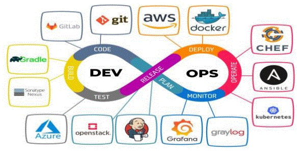

# ControlVersionesGit

## Índice
[1.- Introducción](introduccion.md)

[2.- Sistemas de control de versiones: Git](git.md)

[3.- Lenguaje de marcas: Markdown](markdown.md)

[4.- Repositorio: Github](github.md)

[5.- Conceptos básicos Git/GitHub.](conceptos.md)

[6.- Referencias](referencias.md)

[7.- Autores](autores.md)

## Autores
* **Álvaro Martín** - *Jefe de Equipo* - [Álvaro](https://github.com/alvaroasir-24)
* **Óscar Lavado** - *Desarrollo y documentación* - [Óscar](https://github.com/olv200617-ui)
